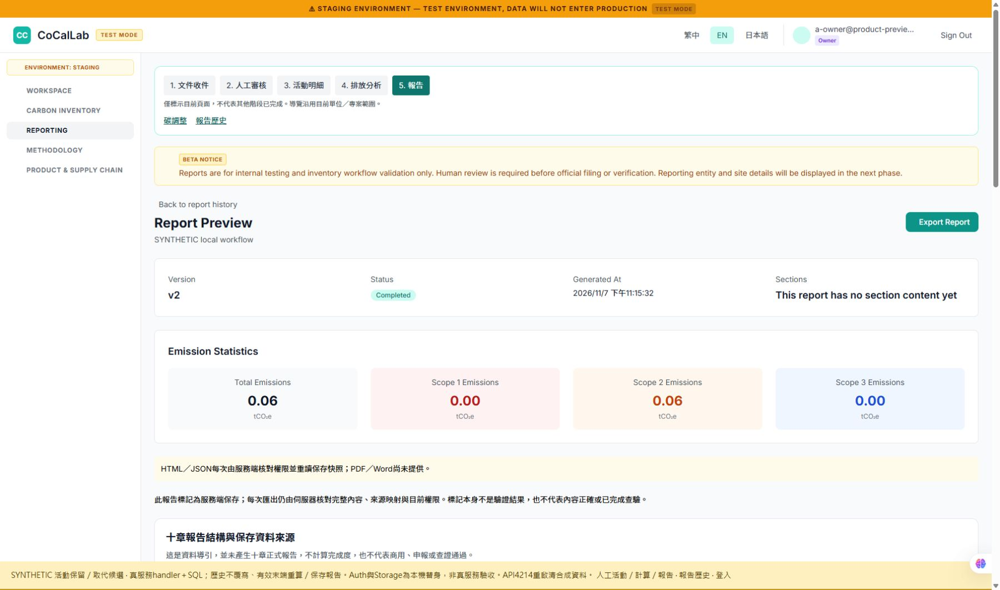

# N3 活動更正／排除交付

RELEASE HOLD。PR #31，branch codex/activity-replacement-20261107；相依PR #30。固定應用程式 **ed6ca9bbfbc5581cdcacf2969340575217fcb8c4**；測試修正 **d761e46e26e2625551781da2120641e8e18c2d1c** 僅變更一個舊fixture，應用程式來源完全一致（SOURCE_EQUIVALENCE.json）。正式UAT基線仍7dccd5452152f2495d10ad1437d5d03215166065；沒有合併main、部署、建立雲端資源或套雲端schema。

## 可操作入口與啟動

目前專用合成API為 http://127.0.0.1:4214，原App為 http://127.0.0.1:4215/login 。a-owner@product-preview.invalid／synthetic-local-only 是本機合成帳號，不能登入任何真服務。既有4206/4207、4212/4213、5432及其他專案保留。

已啟動時直接使用入口。需從同一候選重新建立此專用合成測試時，repo root第一個terminal執行：

~~~powershell
$env:PGLITE_RUNTIME_ROOT=(Resolve-Path ../tooling/sql-runtime).Path
node backend/tools/product-preview/replacement-preview.js
~~~

第二個terminal在frontend/readdy-app執行：

~~~powershell
node node_modules/vite/bin/vite.js --config tools/local-preview/vite.activity-replacement.config.mjs
~~~

API啟動只用專屬4214，若已有監聽即失敗，不自行停止其他服務。重啟會建立全新合成ID/資料；以CLI輸出的activitiesUrl/reportUrl為準，不沿用舊證據ID。啟動回執記checkout SHA/sourceDirty/服務/PID；目前瀏覽器實測服務從ed6啟動且sourceDirty=false，之後只有test/docs提交，程式樹一致。

腳本使用實際本機verify/manual-transcription/confirm/recalc/report handlers與完整schema候選，先保存100kWh/50kg原報告。原件、係數、A/B、角色、Auth與Storage全合成；不是OCR、真正Supabase驗收或正式業務資料。

## 已實跑的操作

1. 登入a-owner，開CLI列出的activitiesUrl。原活動100kWh，既有v1報告50kg（0.05t）。來源為人工轉錄並已確認。
2. 點目前有效列「更正／排除（保留原版）」，模式更正，填非空理由、名稱與120kWh，保存。服務端產新ID；清單保留100歷史與120有效，不直接改原列。
3. 負例：尚未重算就保存報告，明確拒絕CALCULATION_AUTHORITY_STALE。此次明確拒絕後，按「放棄報告恢復參考（不刪除報告）」清除本機參考，再重算。這不刪除伺服器報告；其他未知失回覆仍須保留原ID先核對，不能藉放棄假裝已取消服務端操作。
4. 按「計算並保存／重試」→1筆已計算，再「保存報告快照／重試」→60kg=0.06t，保存並讀回v2。新舊不合計為110kg。
5. 再對120目前有效列選排除，填理由。原quantity/unit唯讀保留120kWh，不填零。保存新版本→重算顯示0筆計算/1筆排除→保存v3，gross0、excluded_count1且理由明確。
6. 開原100活動明細：仍有原數量及50kg歷史計算，版本鏈v1→v2→v3列出操作者、理由、時間；只有v3目前有效。原v1報告仍50kg，v2仍60kg。此處活動status的active不等於目前有效版本，頁面已分開標示。

實際證據：evidence/activity-replacement-20261107/BROWSER_RESULTS.json、PREVIEW_RECEIPT.json與01～09截圖/AX。API另逐列核對原activity、兩筆calc、report、receipt、draft共6筆完整JSON不變；私有proof不變由SQL正反例驗證，未假稱普通API讀到了private表。

## 契約、保留與失敗

最小契約先寫於ACTIVITY_REPLACEMENT_N3_CONTRACT_20261107.md，SQL與統計案例先RED再實作。005的private replacements、延遲FK/relation-first、單一後繼與受控服務保護前版；不建大型版本平台。舊save入口及直接角色寫入不能修改被取代活動。new actor取JWT、scope/訂閱/撤權在SQL重驗，同request回原後繼，之後再取代則回historical，不借新ID冒成功。

來源文件與草稿由服務端繼承並驗仍有效、server-verified原件；不改canonical原稿，不代表內容真實或雙人覆核。更正/排除既有保存報告前後都不重新OCR。未被取代其他活動沿原重算latest語意；本功能只保證被取代前版及其歷史計算逐列不變。

清單保留所有歷史、actor/reason/前後版本；有效views繼承baseRLS，統計/分析/當前計算/新報告採有效集合。未完成included計算時analytics回409 ANALYTICS_CALCULATION_INCOMPLETE，不回部分總量或假零；真零/空集/明確排除維持可讀。原路由、選單、五階段及十章資料導引、HTML/JSON服務端授權未移除；未提供OCR/PDF/Word/人工驗證仍明示狀態。

本機恢復參考按user/org/project/predecessor/request隔離，持久保存意圖；多分頁多參考必須明確選擇，表單與唯讀摘要顯示原意圖。損壞參考可逐一明確放棄，只動本機key，不取消服務端或刪原件。

## 驗證與部署界線

- backend35/35、FE236/236、type/lint/build通過；原生Deno2.9.8共16check/16靜態bundle/hash通過。後端SDK2.49.4與Node本機替身SDK2.57.4分開記錄。
- SQL11與HTTP5、獨立代理子集重疊，不加總。先前全套一條舊overflow fixture失敗已保留；test-only修正以合法合成factor觸發真正22003，沒有改產品schema/權限。最終完整整合374tests＝372PASS／0FAIL／2NOT_RUN，exit0；CI固定d761 Verify source42386465225 success，見VALIDATION.json。
- 005相依070001→002→003→004。模板deployment/uat/candidates/ed6ca9bbfbc5列46個source migration、43個schema候選/3歷史fixture HOLD，16functions均JWT；只做CLI parser scaffold，不操作雲端。
- **既有專案需重新計算，才能產生新版報告；進行中的舊重算可能失敗。** 不自動重算、補簽或覆寫歷史報告。混合舊confirm缺witness的新confirmed會failclosed，004與新handler須成套準備。
- N4兩獨立SQL連線/鎖等待/40P01、真Supabase JWT/PostgREST/Storage/managedEdge/ESZIP、原生chooser/落盤、cloud migration/NOT VALID/DB+Storage復原及19+1仍NOT_RUN。Chrome本機頁面成功不代替這些驗收。

下一步為Claude定向審新005/服務/UI與N1相依交集；不重開H0或P2-1～3。候選來源交付不代表CTO已關閉N1/N3或商業放行。
