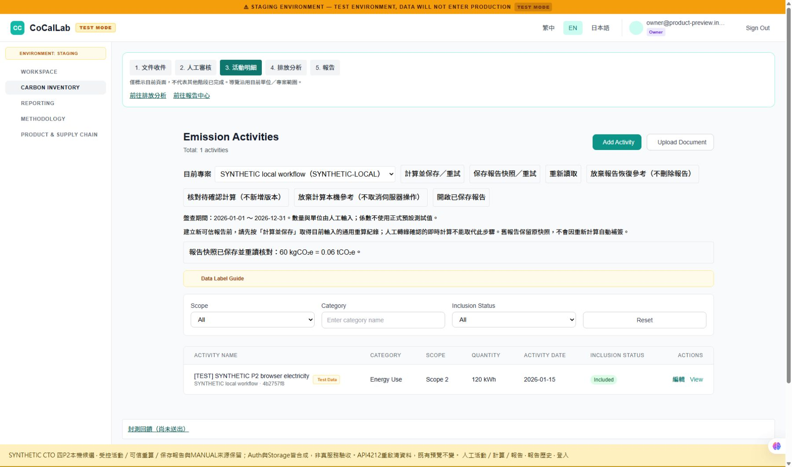

# CTO 四P2整合候選交付 — 2026-11-07

**四P2已完成本機來源修復候選；發布HOLD，未合併、未部署、未操作雲端。** PR30沿PR29相容性候選接續；主程式/SQL/增量測試固定 **9ebf5b13427edf8d228659a24269ddaaf86a84f0**。舊ba2與正式UAT基線7dccd5452152f2495d10ad1437d5d03215166065分開保留。既有路由/選單未刪；原前台/後台仍可載入，本輪並非全功能商用驗收。

## 實際可用行為

| 項目 | 本輪行為／證據 |
|---|---|
| P2-1 受控活動與可信計算 | 人工活動新增/編輯經JWT actor的save-manual-activity/SQL，stable request重送不建第二筆；直接活動/calc寫入拒絕，修改使舊calc失效。新report只用current activities/factors/doc/draft與既有通用重算ledger的最新有效result snapshot；假版本/無authority/改後未算拒絕。來源綁定活動沿原review契約，不開直接覆寫入口 |
| P2-2 舊RPC | 查明004/006內部呼叫鏈後，old recalc/report縮為owner內部可用；一般角色與service直接舊呼叫拒絕，新wrapper/lookup/replay/空project仍正常，不回退繞ledger |
| P2-3/4 MANUAL | provider前與SQL交易均識別所有歷史MANUAL；pending/confirmed/rejected/非latest、canonical raw key及歷史array/scalar marker受保護。processing begin/oldprocess/finish與MANUAL建立兩方向互斥；新稿與確認時驗server-verified仍有效原件，歷史不補簽；合法非MANUAL正例保留 |
| 保留與版本 | public/private report引用的活動、MANUAL/非MANUAL草稿與收件不可刪改；未知歷史mapping保守保留。org/project有report/保留來源或既有ledger FK時禁硬刪並說明，真正空scope可刪。明確32欄位v1/v2 seal，舊v1 verifier保留，新增無關欄位不自動使舊proof失效，不重封存 |
| UI與失敗恢復 | 原活動頁新增受控編輯/穩定request恢復，readonly/撤權/舊scope仍拒；來源保留與需要重算明示。報告export busy綁captured visit+attempt，切scope後舊finally不清新busy、失敗可重試。Project刪除空回覆不再假成功 |

private activity_requests只是受控編輯的request/actor/input/saved-row綁定；不能用可寫audit當authority。沿既有recalc ledger驗計算，未建立大型安全或共用API平台。OCR仍不是本輪完成項，不以Mock補成功；原件hash驗證不證內容真實，人工轉錄可同人確認、不冒稱雙人覆核。

## 真實執行的合成本機瀏覽器流程

入口：[本機原App](http://127.0.0.1:4213/login)，API為loopback4212；既有4206/4207/5432及其他專案保留。兩服務本輪已啟動，是否持續可用以主機程序為準，沒有無限背景保證。

本機明示合成帳號owner@product-preview.invalid／synthetic-local-only；這不是Supabase Dashboard帳號或正式企業帳號。當前[合成設定](http://127.0.0.1:4213/product-api/__synthetic/config)含A/B/shared/viewer IDs，每次重啟會換ID/清除本輪記憶體資料。

1. 原活動頁選SYNTHETIC local workflow，新增100kWh、energy/electricity、人工確認Scope2。
2. 尚未通用重算就保存report，實際顯示CALCULATION_AUTHORITY_REQUIRED；先明確放棄本機report恢復參考（不刪伺服器資料），才可發起新計算。
3. 計算後編輯同活動為120kWh；未重算保存report顯示CALCULATION_AUTHORITY_STALE，總活動仍1筆。清失敗report本機參考，再通用重算。
4. 保存並重讀新快照，畫面顯示 **60 kgCO₂e =0.06 tCO₂e**（合成0.5係數，非正式預設）；開啟保存預覽能讀實際測試資料與缺件導引，不假產十章內容。
5. report引用後嘗試改121，實際REPORT_SOURCE_RETAINED，原活動仍120、report仍60；明確放棄該本機編輯參考後關閉。
6. Export Report只提供HTML/JSON，取消→重開→取消仍可操作；未觸發原生下載。真正delayed React export race只列helper/HTTP測試，不能說browser已驗。

[瀏覽器版本/結果JSON](evidence/cto-p2-browser-20261107/BROWSER_RESULTS.json)固定b7ed0e8；後續9eb僅歷史marker與合成adapter JSON編碼增量，另以單元/HTTP/native驗證，不混稱同一次browser驗全部版本。截圖：



另有01未計算拒絕、02編輯後stale、04來源保留拒編、05保存預覽與06格式對話框同目錄。全為合成資料。

## 驗證收件

| 驗證 | 結果／固定證據 |
|---|---|
| 後端單元 | 31/31 PASS，含contract metadata/marker；範圍重疊不相加 |
| 前端 | 225/225 PASS、app type-check/lint PASS、host build PASS；保留Browserslist age與>500kB bundle warning，不當lint失敗或隱藏 |
| 原生Deno9eb | 15/15 check --all PASS、15/15靜態JS+map，frozen lock與source/tool/bundle hash皆相符；[固定結果](evidence/deployment-preflight-20261107-9ebf5b13427e/RESULTS.md)。不是managed runtime/ESZIP |
| 整合 | 最後固定9eb全套 **337 tests=335PASS/0FAIL/2NOT_RUN，exit0**；兩個skip為獨立SQL連線。先前1f同範圍亦通過，不加總。保留原正反例，舊合法fixture改經真authority，沒有只放寬錯誤regex |
| 固定9eb GitHub CI | [Verify source #42367239996](https://github.com/juliushsu/CoCalLab/actions/runs/42367239996) 已實際success；其不包含native Deno或真服務驗收，後續只加文件的HEAD另記 |
| 獨立交叉 | 一名SQL/RPC、一名服務/UI、獨立審閱；新SQL18及最後保留空scope增量、服務HTTP/FE與P3均有獨立子集。對固定9eb本批無已證未解P1/P2；這不是Claude放行，子集不與全套加總 |

[VALIDATION.json與逐案log](evidence/cto-p2-integration-20261107/VALIDATION.json)。初輪診斷7失敗已逐一查明為新RLS返回0列/物件綁定錯誤/缺少可信authority的舊fixture，保留攻擊與回滾斷言後重跑；不能拿初輪當通過。sandbox原生打包曾因ancestor目錄Access denied失敗，已用授權host分析通過，SANDBOX_ATTEMPT.json記原因，原診斷留本機，未改忽略型別檢查。

## 可重現命令

從repo root（Windows此PC位置C:/Users/User/OneDrive/文件/ChatGPT/CaCalLab/local-uat/CoCalLab-UAT-LOCAL-01/source）：

```powershell
$env:PGLITE_RUNTIME_ROOT=(Resolve-Path ../tooling/sql-runtime).Path
node --test --test-concurrency=1 backend/tests/integration/*.test.js
node backend/tools/deployment-preflight/verify.mjs verify 9ebf5b13427edf8d228659a24269ddaaf86a84f0
node backend/tools/deployment-preflight/summarize.mjs 9ebf5b13427edf8d228659a24269ddaaf86a84f0
```

已有預覽服務不需重啟。只在本輪專用程序停止後，要重新啟動合成API：

```powershell
$env:PGLITE_RUNTIME_ROOT=(Resolve-Path ../tooling/sql-runtime).Path
node backend/tools/product-preview/run.js --verified-upload --port=4212
```

另一shell從frontend/readdy-app：

```powershell
node node_modules/vite/bin/vite.js --config tools/local-preview/vite.cto-p2.config.mjs
```

固定port被佔用時先識別，不停止其他服務。新UAT候選[44 migrations/15functions設定](../../deployment/uat/candidates/9ebf5b13427e/README.md)只是本機準備；完整CLI config同byte parser load PASS，不是雲端或啟動服務。3歷史fixture HOLD/history與NOT VALID仍需核准環境驗證。

## 未驗與接續

- 兩獨立PG連線/鎖等待與鎖順序仍NOT_RUN；PGlite一條serialized連線與Promise.all不能關閉。
- 真SupabaseJWT/PostgREST/Storage/gateway/managed Edge、原生選檔/下載落盤、live migration/NOT VALID/DB+Storage原件復原及19+1驗收未執行。
- [歷史匯出相容提案](HISTORICAL_REPORT_EXPORT_COMPATIBILITY_20261107.md)已具體列影響：legacy讀取保留未驗、無proof不放寬匯出；v1保存proof不等於新來源保證，保留舊驗證器不補簽；上線前需Owner接受標示/外帶方案，現在未擅自改舊資料或商業承諾。
- 本輪不建UAT、不計費、不套雲端migration/bucket/權限或正式資料。Owner既定累計預算與14天上限留受限授權，期限未起算；最新CTO仍未授權建雲端資源。
- 下一步請交Claude使用[單一固定複審入口](CLAUDE_CTO_P2_REVIEW_START_HERE_20261107.md)，只審四P2及修復交集；等其回覆再由CTO裁定。來源候選完成不等於正式四票關閉或發布。
